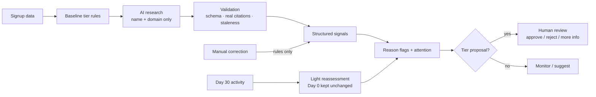

# Navan Growth Intelligence

**Author:** Shahar Izhar
**Submission for:** Navan, Full-Stack Software Engineer, Growth AI Solutions (home assignment)

An internal Growth tool that checks whether a newly signed-up company's tier fits its business-travel potential. It explains why, and lets a person decide what to do.

> **AI researches and interprets. Fixed rules evaluate. Humans approve tier changes.**

All company names and domains are real. All customer values (reported GBV, employee estimates, tiers, 30-day activity) are **fictional scenario data** from the exercise and are never presented as real Navan customer information.

---

## What a salesperson sees

1. **Review queue.** Companies sorted into **Review Now**, **Review Suggested** and **Monitor**, ordered by impact, evidence strength and actionability. Each row shows the company logo, tier (with a ↑/↓ arrow when a change is suggested), reported GBV, employees, the main flag reason and attention. Every table can be sorted.
2. **All companies.** Search plus multi-select filters (tier, flag, attention, research status), so you can pick several values at once.
3. **Company page.** Short, collapsible sections with hover tooltips instead of long text:
   - **Values:** what the tier rules use (reported GBV, employees) next to what research found. Hover a figure to see its source (website domain, page title, date). Click it to jump to the evidence. Figures from the company's own website get a blue check and are listed first. Any value can be corrected in place (rules rerun instantly, no AI call).
   - **Why it was flagged:** flags always in the same order (Tier Mismatch → Data Conflict → Growth Opportunity → Travel Potential → Insufficient Evidence). Each one lists its reasons and, under **Keep in mind**, any caveat specific to this company (for example "only one independent source"). General caveats, such as "growth isn't proof of travel spend", sit in the flag's tooltip.
   - **Research:** field-by-field coverage and sources. Clicking anywhere on a finding opens the source page. **Re-run** and **Deep Research** buttons (Deep Research runs in the background with a progress bar, and is turned off once it has run).
   - **Day 30 activity:** travelers, bookings and trend, with **Update** and **Remove** (see section 6).
   - **Tier change:** each proposal as one line: "↑ Upgrade to Tier 1", the main reason, the type, the status and a **Review →** button. Past proposals are folded away.
4. **Tier review.** Opens with an **AI judge**: one sentence on why the change is proposed, how well the evidence supports it, and the main doubt (advisory only; numbers checked against the evidence). Then a pull-request-style page: current tier → proposed tier, the values behind it, flags, evidence, **Keep in mind**, and **Approve change / Reject change / Add comment**. Tier changes and other important actions ask for confirmation. Every decision is logged.

The signed-in name (top right, "Employee 23" by default) is recorded in the audit trail; click it to change it. Salespeople never see costs or token counts, and prompts are not shown in the UI.

A **Reports** dashboard is planned for the next version. Its data is already available from `GET /api/reports`: flags, review outcomes, research gaps, cost, citation validation, candidate false positives and negatives, and 17 scenario checks.

## Quick start

Requirements: Python 3.11+ and Node 20+.

```bash
# 1. Backend
cd backend
python3 -m venv .venv && .venv/bin/pip install -r requirements.txt
cp .env.example .env          # optional: add ANTHROPIC_API_KEY for live research (see demo mode below)
.venv/bin/uvicorn app.main:app --port 8000

# 2. Frontend (new terminal)
cd frontend
npm install
npm run dev                    # http://localhost:5173
```

The CSV in `data/prospects.csv` is imported automatically on first start. Every company gets a rules-only assessment straight away. Set your name via the user menu (top right), because it's recorded in the audit trail.

**No API key? It still works (demo mode).** With no `ANTHROPIC_API_KEY`, the backend replays **recorded real Claude runs** from `data/demo_snapshot.json`: the 10 demo companies researched live on 8 November 2026, plus the AI judge summary.
- Replays go through the same validation, evidence storage and rules as live research, so flags, proposals and the queue match the live result.
- Everything replayed is labelled **Recorded**, and a purple banner says demo mode is on. Nothing is generated or invented.
- Companies without a recording show "No API key and no recorded research" if you click research.
- Add a key to switch to live research. Set `DEMO_REPLAY=false` to turn replay off.
- To refresh the recordings after live runs: `cd backend && .venv/bin/python -m scripts.export_demo_snapshot`.

**Tests**

```bash
cd backend && .venv/bin/python -m pytest -q     # 91 tests
cd frontend && npm test                          # 14 smoke tests
```

### A 5-minute demo

1. **Day 0 conflict (IMU Biosciences, P-007).** Open the company. It is Tier 2 *only* because the enrichment says 155 employees ($48K GBV). Public research finds 25 (PitchBook) and 53 (Built In) employees, plus an 11-50 LinkedIn band. The two straddle 150, so the system raises a **material Data Conflict** and a Tier 2 → Tier 3 standard-rule proposal. Open the review and reject or approve it with a comment.
2. **Manual enrichment, no AI.** On Quantum Motion (P-011, headcount missing, provisional Tier 3), click **Edit** on Employees and enter 180. The before/after diff shows baseline Tier 2 and a new proposal. 0 AI calls are made, and the applied tier doesn't change until someone approves.
3. **Day 30.** On *All companies*, click **Receive all Day 30 activity**. Strong activity on Tier 2 companies (NexGen Cloud, Puttshack) shows as Travel Potential for review; it never proposes Tier 1. Each company's Day 0 assessment stays unchanged in its history.
4. **Restart the backend.** All decisions, evidence and audit events are still there (SQLite).

---

## How it works

See the full chart with decision notes in [`docs/flowchart.md`](docs/flowchart.md), or open [`docs/business-logic.excalidraw`](docs/business-logic.excalidraw) at [excalidraw.com](https://excalidraw.com) (menu → Open) for an editable diagram of the business logic.



### 1. Baseline tier (deterministic, Navan's rules)

- Tier 1: GBV ≥ $500K.
- Tier 2: GBV ≥ $100K, or 150+ employees.
- Tier 3: everyone else.

Edge cases:
- **Missing headcount with GBV < $100K** gives a *provisional* Tier 3, because headcount eligibility can't be ruled out.
- **Missing, negative or unparseable GBV** gives no tier and a data-quality issue. It is never treated as $0.
- The dataset tier (`original_tier`), the calculated baseline, and the tier currently applied in the prototype are stored separately.

**Dataset finding:** all 43 `current_tier` values already match the rules. Mismatches therefore come only from research, manual corrections, or Day 30 activity.

### 2. Research (AI)

- **Model:** Claude Haiku 5.5 with Anthropic's server-side web search, at most 5 searches per standard run.
- **Standard research (prompt v4)** covers the routing basics: industry, locations, employees, funding, hiring. **Deep Research** covers all 8 fields, adding travel requirements, recent expansion and support complexity. Fields a run didn't cover show **Not searched**.
- **Fields:** industry and business model, geographic footprint, employee count, hiring trends, **direct travel indicators**, funding, expansion, support complexity.
- **Output:** structured findings, each with source URL, title, publisher, date, `observed`/`inferred`, and signal type (`direct_travel`, `indirect_growth`, `descriptive`).
- **Inputs:** the prompt contains only the company name and domain. It never contains reported GBV or Day 30 data.

The AI's output is not trusted as-is:

| Check | What happens |
|---|---|
| JSON schema (Pydantic) | One repair retry without web search, then the run is marked failed with the raw text kept. The closing summary line is optional, because long Deep Research answers sometimes leave it out |
| Citation check | Findings whose URL wasn't among the search results returned in that run are dropped and logged |
| Headcount bands | "51-200" or "fewer than 25" can't be used as an exact number (cleared deterministically) |
| Dates | Evidence older than 18 months is marked **Stale**. Evidence dated after the research run is dropped |
| Source reliability | Company site or registry / independent source / data aggregator, decided by domain |
| Timeouts, API errors, missing key | Recorded on the run and shown in the UI; the rules keep working |

**Deep Research runs in the background.** The company page shows a progress bar with the current step (starting, searching the web, checking sources, saving). It keeps running if you leave the page and refreshes the findings when done. Only one Deep Research runs per company at a time; a run cut off by a server restart is marked as interrupted.

**Cost controls:**
- Results are cached per company and prompt version.
- Standard research runs only for a configured demo set of 10 companies, or when someone clicks it.
- **Deep Research** runs only after a confirmation dialog explaining what it will do. It reuses existing evidence as context and adds new evidence without deleting old evidence. Once it has run, the button is turned off and it's no longer suggested.
- Each run records tokens, searches and an approximate cost for the team running the tool (not shown to salespeople).
- A failed run whose search results were saved can be re-checked later without a new AI call (`reprocess_run`), e.g. after a validation fix.

### 3. Reason flags (deterministic, may be several)

| Flag | Fires when | Never fires on |
|---|---|---|
| **Data Conflict** | Employee figures fall on both sides of 150 (**material** if GBV < $100K, because then headcount decides the tier), or differ by more than 50%. A verified manual value downgrades it to "resolved" | Differences in non-routing fields such as funding totals |
| **Travel Potential** | A source *states* employees travel for work (job ad, field or client-site work). **Material** with 2+ independent sources. Informational only on Tier 1 | Aggregator-only, inferred, or **local field travel** (home visits, mileage), which doesn't create bookable travel |
| **Growth Opportunity** | 2+ independent growth signals (funding, expansion, hiring, international footprint). Multiple articles on one announcement count once | — never drives a tier change; its tooltip says "growth isn't proof of travel spend" |
| **Insufficient Evidence** | Headcount unknown and nothing found, invalid GBV, or research found nothing in 5+ of 8 fields | — its tooltip says "missing isn't the same as 'doesn't travel'" |
| **Tier Mismatch** | The standard rules (with accepted values) give a different tier, research headcount would change the tier, strong direct travel evidence on a Tier 3, or material Day 30 activity | Informational flags alone |

### 4. Attention, proposals and reviews

These four things are kept separate:
- **Tier**: the support level.
- **Flag**: why the company was flagged.
- **Attention**: when someone should look.
- **Review status**: where a proposal stands.

How attention is assigned:
- **Review Now**: an open tier proposal, or a conflict that decides tier eligibility.
- **Review Suggested**: moderate signals, such as one source of travel evidence, a conflict that doesn't change the tier, or growth near a tier threshold.
- **Monitor**: weak signals only.

How proposals are made:
- Only Tier Mismatch creates a proposal. Proposals are typed as **standard-rule correction** or **evidence-based override**.
- They are deduplicated per target tier. A proposal a reviewer rejected is not raised again unless new evidence appears. A proposal the latest evidence no longer supports is marked **No longer needed**.
- **Approve** changes the applied tier and keeps the original and previous tier. Approving a research-headcount correction also records that headcount as reviewer-accepted, so the rules stay consistent. Approving an override is logged as a policy override.
- **Reject** requires a reason.
- **Add comment** records a note and keeps the proposal open.

### 5. Manual enrichment

A Growth employee can set employee count, a direct travel requirement, funding, expansion, geographic footprint, or a free-text note:
- Each entry is a new evidence row. Original research is never edited.
- It is **Verified** only with a source URL and an explicit check; otherwise it shows as *unverified*.
- Saving reruns the rules immediately with **0 AI calls** (tested) and shows a before/after diff.
- A free-text note is explanatory only.
- An entry can be withdrawn, and it stays in history.

### 6. Day 30 reassessment

Day 30 numbers can be **updated** or **removed**. Both ask for confirmation and are logged:
- **Update:** travelers, bookings in 30 days, and optional free-text remarks. The booking trend is calculated by the server from the previous bookings to the new ones (318 → 400 = ↑26%), so it always matches the numbers; the dialog previews it. The first arrival from the dataset keeps the file's own trend (days 16–30 vs days 1–15). The trend's tooltip says which comparison is shown.
- **Remove:** the company goes back to its signup assessment, and any tier change suggested from the activity is withdrawn.

Day 30 activity is imported into a separate table and stays *unreceived* until released, so it can't influence signup routing. When it arrives:
1. A new rules-only assessment compares it with the latest Day 0 assessment, and says whether the activity *strengthens*, *weakens* or is *consistent with* it.
2. Activity is material at 15+ travelers, or 40+ bookings growing 25%+. Day 30 never proposes Tier 1: Tier 1 depends on reported GBV ($500K+), and booking counts can't show dollars. Strong activity on a Tier 2 company becomes a Travel Potential flag (Review Suggested).
3. The only proposal Day 30 can make is Tier 3 → Tier 2, as an evidence-based override, because **booking counts are not dollars**.

Results on the 10 dataset rows:

| Company | Activity | Day 30 effect (verified in an end-to-end run) |
|---|---|---|
| NexGen Cloud (T2) | 83 travelers, 318 bookings, +12% | Travel Potential (Day 30), no proposal |
| Greyparrot (T2) | 42 travelers, 151 bookings, +58% | Travel Potential (Day 30), no proposal |
| Puttshack (T2) | 44 travelers, 140 bookings, +42% | Travel Potential (Day 30), no proposal |
| IMU Biosciences (T2) | 19 travelers, 57 bookings, +62% | Travel Potential (Day 30), no new proposal; "strengthens" |
| Attio (T3) | 6 travelers, 21 bookings, +80% | Growth Opportunity, Review Suggested (below the review threshold) |
| Callosum, Metaview (T3) | 1–5 travelers, flat / −22% | Monitor |
| Bionical (T3) | 9 travelers, −35% | Recorded as **weakening** the Day 0 travel signal; stays Review Now for its headcount conflict |
| Valarian, Balfour Beatty (T1) | strong | Consistent with Tier 1, no action |

These thresholds are **prototype hypotheses**, configurable in `backend/app/config.py`, and are not statistically validated.

---

## Representative cases

See [`docs/cases.md`](docs/cases.md) for live-research results on the demo companies, with real sources.

## LLM use, testing and refinement

See [`docs/llm_experiments.md`](docs/llm_experiments.md). In short:
- Prompt v1 was run live on IMU Biosciences, NexGen Cloud and Moorside Manufacturing, plus a conflict test that mixed a synthetic 90-employee value with the dataset's 155.
- **Three real failures were found:**
  - headcount bands such as "101-250" were stored as exact numbers;
  - travel requirements weren't actively searched, so travel indicators were not found in 3 of 3 runs;
  - ordinary database differences were reported as conflicts.
- **v2** combined prompt changes with two deterministic guards.
- **Re-run results:**
  - band numbers were removed;
  - every run made a dedicated travel search, and it found a real job posting requiring global travel for NexGen;
  - fields marked conflicting fell from 2–3 per company to 0.
- **Second iteration (v3):** running the full app on 10 live companies exposed six more errors, each fixed with a regression test. The most important: community-nurse home visits (mileage, car allowance) were counted as business travel and created a false Tier 3 → Tier 2 override. v3 labels every travel finding `business_travel`, `local_field_travel` or `unclear`, and local travel can't drive an override.
- Remaining limitations are listed in that doc.

## Evaluation

See [`docs/evaluation.md`](docs/evaluation.md). It covers how false positives, false negatives and unsupported actions are measured, what can be shown with scenario tests now versus what needs verified production outcomes, and the error-analysis loop. **No accuracy figure is claimed.** The dataset is fictional and unlabelled.

## Assumptions

| Assumption | Why |
|---|---|
| Signup cutoff = the research run time | The dataset has no signup dates. Each run stores its cutoff; later-dated evidence is dropped |
| Stale = older than 18 months | A reasonable default for company facts, configurable |
| Day 30 data is "received" by clicking a button | Simulates arrival; the CSV contains it from the start |
| Research headcount never silently replaces enrichment | A disagreement becomes a conflict and a proposal for a human |
| Priority = impact → evidence strength → actionability | Shown as High/Medium/Low, never as a probability or dollar figure |
| Auto-research covers 10 demo companies | Keeps API cost bounded. `AUTO_RESEARCH_ON_IMPORT=true` researches the demo set on start, and any company can be researched with one click |

## Limitations

- Prototype only; tier changes apply inside this app, not to Navan's routing.
- Public research leans heavily on data aggregators, whose headcounts are estimates and often undated.
- Small private companies may have almost no public data. The system shows "Not found" and never infers "no travel".
- Job postings are a snapshot; finding none does not mean no travel.
- Company identity is confirmed by the model (for example, via company numbers) but not independently verified.
- The policy thresholds are not calibrated, and no real outcome data exists to calibrate them.
- 30 days of bookings cannot estimate annual GBV.
- No authentication: the name in the user menu is only used for the audit trail.
- Company logos come from Google's favicon service (only the domain is sent); sites without one show a globe.
- With standard research narrowed to 5 fields (v4), travel requirements are only found by Deep Research, so a standard-only assessment can't raise Travel Potential.

## Project structure

```
backend/prompts/           every AI prompt as a plain file (research v1–v4, deep, repair, judge)
                           + manifest.json (active version). Edits apply on the next AI call.
backend/app/
  rules/baseline.py        Navan tier rules
  importer.py              CSV import (Day 30 kept separate)
  research/                prompt loader, client (Anthropic + web search), judge, replay,
                           schema (Pydantic), evidence validation, service (cache, repair, storage)
  assessment/              signals → flags → attention → proposals; day30.py; engine.py (reassess, no LLM)
  reviews/service.py       approve / reject / request info + audit
  enrichment.py            manual values, synthetic test evidence
  api/routes.py            FastAPI endpoints
backend/tests/             91 pytest tests
backend/scripts/prompt_experiment.py   reproduces the LLM experiments
frontend/src/pages/        ReviewQueue, Companies, CompanyDetail, TierReview, Reviews (14 Vitest smoke tests)
docs/                      flowchart, llm_experiments (+ raw outputs), evaluation, cases
```

Stack: FastAPI, SQLModel/SQLite, Pydantic, the Anthropic Python SDK, React + TypeScript (Vite), pytest, and Vitest + Testing Library.

## AI tools used

- **Claude Code (Claude Opus 5.5)** helped build this submission: planning against the brief and PRD, writing the backend, frontend, tests and documentation, and running the live LLM experiments. I set the product decisions and reviewed the output.
- **Claude Haiku 5.5 + Anthropic web search** is the research engine *inside* the application. Its real outputs are in `docs/experiments/`.
- No other AI tools were used.

## Changing a prompt

The app sends one live prompt per task. They are plain text files in `backend/prompts/` (`research.*`, `deep.*`, `judge.*`, `repair.user.txt`), described in `backend/prompts/manifest.json`.
1. Before editing, copy the current research prompt into `docs/experiments/prompts/` as the next archived version (today's live prompt is archived there as `research_v4.*`).
2. Edit `backend/prompts/research.*.txt` and bump `research.version` in the manifest (e.g. `v5`). The version is stored on every run, and the cache is tied to it, so a new version triggers fresh research.
3. Run `cd backend && .venv/bin/python -m scripts.prompt_experiment --cases P-007 P-025` and compare `docs/experiments/v5/` with earlier versions.
4. Regenerate the prompt snapshot on purpose: `.venv/bin/python -m tests.golden_prompts > tests/fixtures/prompt_golden.json`. Until you do, `tests/test_prompt_refactor.py` fails on any prompt change, so nothing changes by accident.

Placeholders in `{braces}` are filled by code. Earlier versions (v1–v3) and why each changed: [`docs/experiments/prompts/`](docs/experiments/prompts/README.md). `tests/test_prompts.py` checks they still reproduce the prompts sent in the saved experiments.
