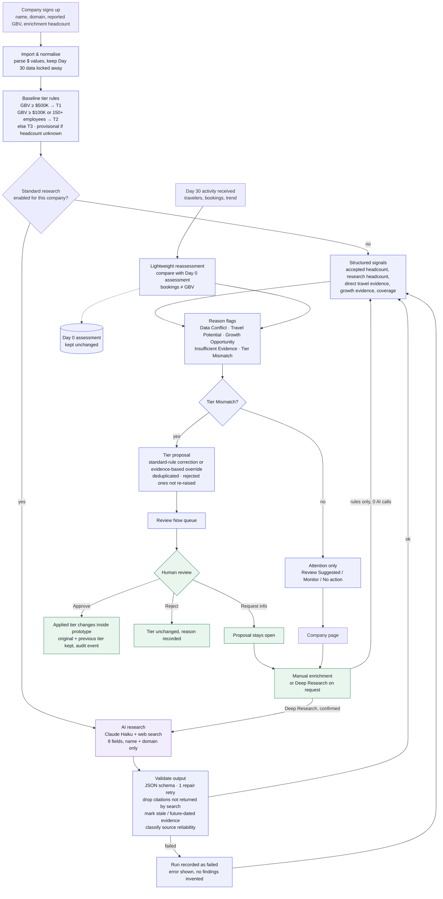

# System flowchart

Blue = deterministic code, purple = AI (LLM + web search), green = human decision. Nothing on the AI path can change a tier.

## Key decisions shown in the chart

| Decision point | Rule | Why |
|---|---|---|
| Which inputs the AI sees | Company name + domain only | Research stays independent of the reported GBV, and Day 30 data cannot leak into it |
| What the AI may output | Findings with source URLs, field statuses, conflicts | The AI interprets evidence; it never assigns tiers or flags |
| Citation check | URL must be among the search results actually returned in that run | Prevents fabricated sources reaching the UI |
| Research headcount vs enrichment | Research never silently replaces the enrichment value; disagreement becomes a Data Conflict | Keeps a human in charge of the value that drives the tier |
| Conflict severity | "Material" only when the sources straddle 150 **and** GBV is below $100K | That is the only case where headcount decides the tier |
| Travel Potential | Needs direct evidence (job ads requiring travel, field or client-site work). Aggregator-only or inferred evidence does not count | Growth is not travel |
| Tier 3 → Tier 2 override | Direct travel evidence from 2+ independent sources | One source is enough to suggest a look, not a re-route |
| Day 30 proposal | At most one tier up, always typed as an override | Bookings are not dollars |
| After a rejection | The same proposal is not raised again unless new evidence appears | Avoids nagging reviewers |
